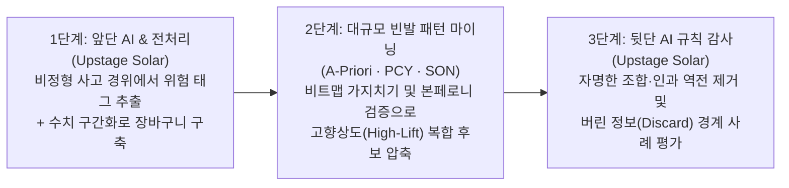

> [!IMPORTANT]
> **팀원·AI 에이전트 공통:** 작업 전에 [AGENTS.md](AGENTS.md)(협업 규칙)를 먼저 읽고 따르세요. AI 에이전트는 종류와 관계없이 이 규칙을 적용하고 팀원에게 알려야 합니다.
> Git이 처음이면 [CONTRIBUTING.md](CONTRIBUTING.md)를, 데이터 규칙은 [data/README.md](data/README.md)를 보세요.
> `main`에 직접 푸시하지 말고 브랜치 → PR로 작업합니다. 머지는 팀장만 합니다.

# 🔥 A-Priori·PCY 알고리즘과 Upstage Solar 에이전트를 결합한 복합 화재 발생 위험 패턴 마이닝
> **Composite Fire Risk Pattern Mining Combining A-Priori/PCY Algorithms and Upstage Solar Agents**  
> **과목 (Course):** 2026-2 빅데이터개론 (Introduction to Big Data · Mining of Massive Datasets)

---

## 🇰🇷 국문 프로젝트 설명 (Korean Version)

### 1. 해결할 문제 (Problem to Solve)
화재 사고는 단일 원인으로만 발생하거나 대형화되지 않습니다. 똑같은 전기적 요인이라도 **'심야 시간대 + 낮은 습도 + 노후 다세대 구조 + 초기 소화 설비 미작동'**처럼 여러 환경·구조·시간적 조건이 **동시에 결합될 때** 인명 및 대형 재산 피해로 이어집니다. 그러나 기존의 화재 통계 분석과 단순 AI 접근법은 다음과 같은 한계를 가집니다.

1. **단일 변수 집계(1차원 통계)의 한계:** 기존 통계는 '월별 화재 건수', '원인별 화재 비율'처럼 개별 변수를 따로 집계하기 때문에, 평소에는 눈에 띄지 않다가 **특정 조건들이 동시에 겹칠 때 위험도가 급증하는 '복합 발생 패턴'**을 포착하지 못합니다.
2. **전수 LLM 분석의 비용·규모 병목:** 수만~수십만 건에 달하는 화재 사고 기록 전체를 LLM에게 직접 읽혀 복합 패턴을 찾으려 하면 API 호출 비용과 시간이 폭발하며, LLM은 전체 데이터셋 수준의 정확한 지지도(Support)와 향상도(Lift)를 계산하지 못합니다.
3. **순수 장바구니 알고리즘(A-Priori) 단독 사용의 한계:**
   - **메모리 병목:** 항목(조건) 수가 늘어날수록 2-항목 후보 쌍($C_2$)이 기하급수적으로 폭발합니다.
   - **정보 손실(The Discard)과 가짜 패턴 범람:** 계산 효율을 위해 연속적인 수치와 사건의 선후 순서(인과관계)를 버리고 이진(0/1) 장바구니로 단순화하기 때문에, 결과물 속에 *"겨울철 + 건조 → 난방기구 화재"* 같은 **너무 당연한 조합(Trivial Rules)**과 **본페로니 원리(Bonferroni's Principle, §1.2)**에 의해 우연히 묶인 **통계적 인공물(가짜 연관 규칙)**이 대량으로 섞여 나옵니다.

> **🎯 핵심 연구 질문 (Research Question):**  
> *"연속 수치와 사건 순서를 버리는(Discard) 장바구니 모델에서 PCY 해시 비트맵 가지치기와 본페로니 기준선으로 전체 화재 조건 조합의 99%를 압축한 뒤, 걸러진 상위 후보 규칙만 Upstage Solar 에이전트로 감사(Audit)하면, 단순 빈도 기준선 대비 높은 정밀도로 '자명한 규칙'을 제거하고 실제 예방 가능한 '숨은 복합 화재 위험 패턴'을 발굴할 수 있는가?"*

---

### 2. 데이터 및 방법 (Data & Methodology)

#### 📊 활용 데이터 (Data)
- **국가화재정보시스템(NFDS) 및 공공데이터포털 소방청 화재 발생 현황 데이터** (연간 수만 건 규모)
  - **정형 변수:** 발생 일시(계절·요일·시간대), 기상 조건(기온·실효습도·풍속), 건축물 특성(용도·구조·층수), 발화 열원 및 발화 요인, 초기 진화 여부, 인명·재산 피해 규모
  - **비정형 변수:** 화재 현장 출동 및 사고 경위 요약 텍스트 (비정형 정황 기록)

#### 🛠️ 분석 방법론: 3단계 하이브리드 파이프라인 (Methodology)

1. **[1단계] 장바구니(Market-Basket) 변환 및 Upstage Solar 앞단 태그 추출**
   - 각 화재 사고 1건을 **장바구니(Basket) 1개**로, 당시의 환경·건물·발화 조건들을 **아이템(Item)**으로 모델링합니다.
   - 정형 표에 담기지 않은 비정형 사고 개요 텍스트에서 **Upstage Solar 에이전트**가 핵심 위험 요인 태그(예: `#문어발콘센트`, `#방화문개방`, `#적치물방치`)를 자동 추출하여 장바구니 아이템으로 결합합니다.
2. **[2단계] 교재 6장 빈발 항목집합 마이닝 (`A-Priori` · `PCY` · `SON`) 및 1장 `본페로니 원리` 적용**
   - **A-Priori (§6.2) vs PCY (§6.3.1):** 기본 A-Priori의 Pass 2에서 발생하는 후보 쌍($C_2$) 폭발 문제를 해결하기 위해, Pass 1의 유휴 메모리를 해시 버킷과 **비트맵(Bitmap)**으로 활용하는 **PCY 알고리즘**과 청크 분할 기반 **SON 알고리즘(§6.4.2)**을 구현하여 메모리 절감률과 실행 속도를 비교합니다.
   - **본페로니 원리 (§1.2) 기준선 검증:** 완전 무작위 독립 가정하에서 우연히 임계 지지도($s$)를 넘길 것으로 기대되는 가짜 쌍(Bogus Pairs)의 기댓값을 계산하여 지지도($s$)와 향상도(Lift) 임계값을 설정합니다.
   - **무엇을 버렸는가 (The Discard):** 연속적인 기상·피해 수치를 이진(0/1) 구간으로 양자화하며 **세부 수치 차이와 사건의 시간적 선후(인과) 순서를 버렸고**, 최소 지지도($s$) 미만의 **희귀 대형 특수 화재(Long-tail)**를 버렸습니다.
3. **[3단계] Upstage Solar 뒷단 감사(Auditor) 에이전트를 통한 정밀 평가**
   - 2단계 코드가 걸러낸 상위 연관 규칙($A \cup B \to \text{대형 피해}$) 후보군을 **Upstage Solar 에이전트**가 평가합니다.
   - ① 누구나 아는 **자명한 규칙(Trivial Rules)**과 순서 정보가 버려져 발생한 **인과 역전 규칙**을 제거하고, ② 지지도($s$) 경계선에서 아깝게 버려진(Discard) 고위험 특수 화재 사례를 재검토하여, 실제 소방 점검에 즉시 활용 가능한 **'핵심 복합 화재 위험 패턴'**을 최종 도출합니다.

---

### 3. 만들 결과물 (Deliverables)
1. **장바구니 전처리 및 빈발 항목집합 마이닝 엔진 (`Python`)**
   - 화재 공공데이터를 장바구니 트랜잭션으로 변환하는 모듈 및 **A-Priori / PCY / SON 알고리즘 직접 구현 코드**
   - 지지도($s$) 변화에 따른 후보 쌍($C_2$) 크기, 메모리 사용량(Floats/Bytes), 실행 시간 비교 벤치마크 리포트
2. **Upstage Solar 2단 에이전트 시스템 (`Solar Seed/Tag Extractor & Rule Auditor`)**
   - 앞단: 비정형 화재 경위서에서 위험 조건 아이템을 추출하는 Solar 프롬프트·파이프라인
   - 뒷단: PCY가 도출한 연관 규칙을 감사하여 `자명한 규칙(Trivial)` vs `우연한 규칙(Spurious)` vs `실질적 숨은 위험 패턴(Actionable)`으로 분류하고 정량 비율(%)을 산출하는 감사 에이전트
3. **복합 화재 위험 패턴 분석 보고서 및 재현 가능한 시각화 패키지**
   - 복합 화재 발생 네트워크 그래프, 지지도-향상도(Support-Lift) 산점도, PCY 메모리 절감 곡선 및 모든 그림을 100% 동일하게 재생성하는 원클릭 재현 스크립트(고정 시드 포함)

---

### 4. 진행 방식 (Process)
- 본 프로젝트는 단계별로 끝내고 넘어가는 **Waterfall 방식이 아닌 Agile 방식**으로 진행합니다.
- 세부 운영 방식(반복 주기, 백로그 관리, 회의 등)은 팀 합의 후 이 섹션에 추가합니다.

---
---

## 🇺🇸 English Version (Project Description)

### 1. Problem to Solve
Fire accidents rarely escalate into severe disasters due to a single isolated factor. Even with the same electrical cause, catastrophic casualties and property damage occur when multiple environmental, structural, and temporal conditions **co-occur simultaneously**—for example, `{Late Night + Low Humidity + Aging Multi-family Housing + Malfunctioning Initial Extinguisher}`. However, conventional fire statistics and naive AI approaches face three critical limitations:

1. **Limitation of 1D Marginal Statistics:** Traditional fire reports aggregate variables individually (e.g., monthly fire counts, percentages by primary cause), failing to capture **composite risk patterns** that appear benign in isolation but drastically amplify danger when combined.
2. **Cost & Scale Bottleneck of Full-Dataset LLM Processing:** Feeding tens of thousands of fire incident records directly into an LLM causes prohibitive API costs and latency, while LLMs inherently struggle to compute exact dataset-wide Support, Confidence, and Lift metrics.
3. **Limitations of Standalone Market-Basket Mining (A-Priori):**
   - **Memory Bottleneck:** As the number of condition items grows, candidate pairs ($C_2$) explode combinatorially in Pass 2.
   - **Information Loss (*The Discard*) & Spurious Rules:** Because basket models discard continuous numerical magnitudes and temporal/causal ordering in favor of binary (0/1) co-occurrence, raw algorithm outputs are flooded with **trivial rules** (e.g., `{Winter + Dry Weather} -> {Heater Fire}`) and **statistical artifacts (bogus rules)** predicted by **Bonferroni's Principle (§1.2)**.

> **🎯 Core Research Question:**  
> *"In a market-basket model that discards continuous magnitudes and temporal order, if we prune 99% of fire condition combinations using PCY hash-bitmap filtering and Bonferroni baselines and then audit only the top candidate rules with an Upstage Solar agent, can we filter out trivial/spurious rules with significantly higher precision than frequency baselines alone and uncover actionable composite fire risk patterns?"*

---

### 2. Data & Methodology

#### 📊 Data
- **National Fire Data System (NFDS) / Korea National Fire Agency Public Fire Incident Dataset** (Tens of thousands of incident records)
  - **Structured Attributes:** Timestamp (season, day of week, hour bucket), weather conditions (temperature, effective humidity, wind speed), building profile (usage type, structure, floor level), ignition heat source & factor, initial suppression status, and casualty/property damage scale.
  - **Unstructured Text:** On-site fire dispatch and incident summary narratives.

#### 🛠️ Methodology: 3-Stage Hybrid Pipeline
1. **[Stage 1] Market-Basket Modeling & Front-End Tag Extraction via Upstage Solar**
   - Each fire incident is modeled as a **Basket (Transaction)**, and its co-occurring environmental, structural, and ignition conditions are modeled as **Items**.
   - An **Upstage Solar Agent** reads unstructured incident summary narratives to extract latent risk tags (e.g., `#OverloadedPowerStrip`, `#BlockedFireDoor`, `#FlammableClutter`) that are missing from structured columns and appends them to the transaction baskets.
2. **[Stage 2] Massive Frequent Itemset Mining (`A-Priori`, `PCY`, `SON` — Ch. 6) & `Bonferroni's Principle` (Ch. 1)**
   - **A-Priori (§6.2) vs. PCY (§6.3.1) & SON (§6.4.2):** To overcome the $C_2$ candidate pair explosion in A-Priori, we implement the **PCY algorithm** (utilizing idle memory in Pass 1 for hash buckets and a **bitmap** filter) and the chunk-based **SON algorithm**, benchmarking memory reduction and execution speed.
   - **Bonferroni Baseline (§1.2):** We compute the expected number of random co-occurrences under an independence assumption to set rigorous support ($s$) and lift thresholds against false discoveries.
   - **What Is Discarded (*The Discard*):** By binarizing continuous weather/damage variables into discrete items, the method **discards fine-grained numerical differences and temporal/causal ordering**, as well as **rare, low-support catastrophic incidents (long-tail events)** falling below threshold $s$.
3. **[Stage 3] Back-End Rule Auditing & Discard Analysis via Upstage Solar Agent**
   - The **Upstage Solar Auditor Agent** evaluates the high-lift association rules ($A \cup B \to \text{Severe Damage}$) filtered by Stage 2.
   - It (1) separates **trivial common-sense rules** and **causal-inversion errors** (caused by discarding temporal order) from **genuinely actionable composite risk patterns**, and (2) inspects boundary cases discarded near threshold $s$ to generate practical fire-prevention inspection checklists.

---

### 3. Deliverables
1. **Market-Basket Preprocessor & Frequent Itemset Mining Engine (`Python`)**
   - Transaction builder for public fire datasets and from-scratch implementations of **A-Priori, PCY, and SON**.
   - Benchmark suite measuring $C_2$ candidate explosion, bitmap pruning ratio, memory footprint, and runtime across varying support thresholds ($s$).
2. **Upstage Solar Dual-Agent Pipeline (`Tag Extractor & Rule Auditor`)**
   - Front-end Solar module for extracting structured risk items from raw incident narratives.
   - Back-end Solar Auditor module that classifies candidate association rules into `Trivial`, `Spurious`, and `Actionable Composite Patterns`, reporting quantitative precision gains over raw A-Priori outputs.
3. **Composite Fire Risk Report & Reproducible Visualization Suite**
   - Co-occurrence network graphs, Support-Confidence-Lift scatter plots, PCY memory reduction curves, and one-click reproducible scripts with fixed random seeds (`SEED = 42`).

---

### 4. Process
- This project follows an **Agile approach, not Waterfall** (no finishing each phase completely before moving to the next).
- Details (iteration length, backlog management, meetings) will be added to this section once the team agrees on them.
